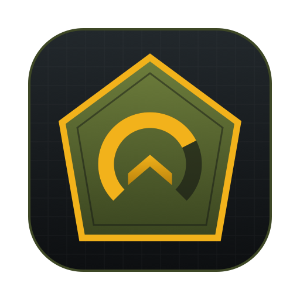
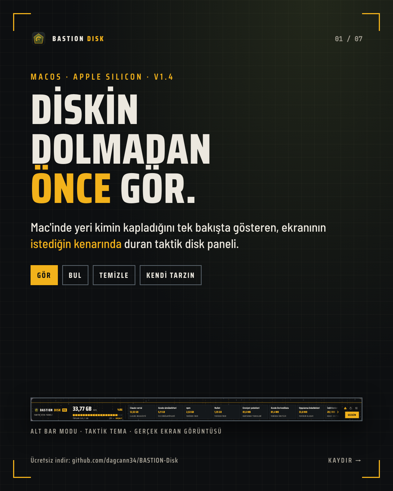
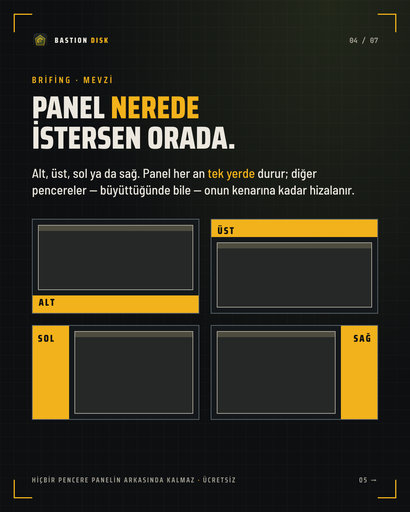
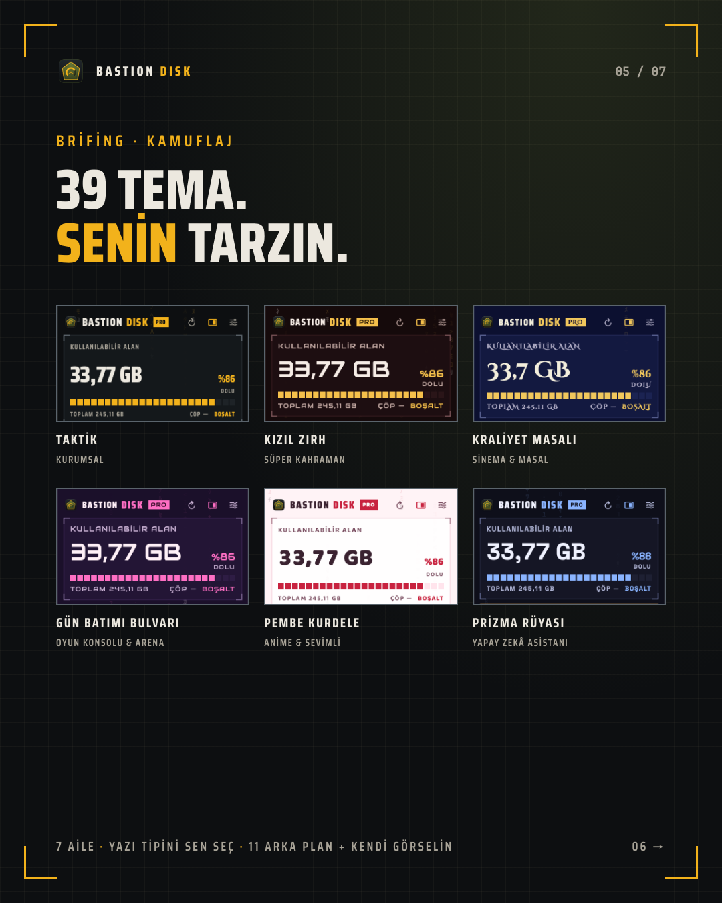

<p align="center"></p>

<h1 align="center">BASTION Disk</h1>
<p align="center"><b>See your disk filling up before it's full.</b><br>A tactical disk panel that docks on any edge of your Mac's screen.</p>

<p align="center"><a href="README.md">Türkçe</a> · <b>English</b></p>

<p align="center">
  <a href="https://github.com/dagcann34/BASTION-Disk/releases/latest"><b>⬇️ Free download (macOS 14+, Apple Silicon)</b></a>
  &nbsp;·&nbsp; ⭐ Pro: inside the Mac App Store version
</p>

<p align="center"></p>

> **Language note:** The app's interface is currently in **Turkish only**. Menu and button names below are given in Turkish as they appear in the app, with an English translation in parentheses.

## What it does

- **SEE** — Free space, a segmented usage gauge and a live counter in the menu bar.
- **FIND** — A TreeSize-style browser: folders sorted by size, hidden folders included (`~/Library`, `.cache`, package caches).
- **CLEAN** — Move to Trash (undoable), or delete permanently with Pro. Core macOS folders are protected, sensitive locations get an extra warning, and every permanent action asks for confirmation.
- **FOUR EDGES, ONE PANEL** — The panel sits on the bottom, top, left or right edge; other windows (maximized ones included) snap up to its edge.
- **39 THEMES, 7 FAMILIES** — Pick your own fonts and backdrop, or use your own image.
- **NO NETWORK, NO TELEMETRY** — The app never connects to any server.

<p align="center"> </p>

## Free and Pro

The **BASTION Disk** you download here is **free**. License keys are no longer sold; the "PRO · 1.000 TL" link in the app is no longer used.

Pro features unlock **inside** **BASTION Disk Pro**, a separate app that is a free download on the Mac App Store, with a one-time In-App Purchase (the App Store version is being prepared for release):

| BASTION Disk Pro (Mac App Store) | Free | Pro — In-App Purchase, one-time |
|---|---|---|
| Free-space gauge, folder explorer, Move to Trash | ✓ | ✓ |
| Screen-edge panel, menu bar counter | ✓ | ✓ |
| Watched folders, size history, "what grew" | — | ✓ |
| Low-space and growth alerts | — | ✓ |
| All themes, fonts, backdrops and your own image | — | ✓ |

Purchases and restores are handled by Apple (**Unlock Pro…** › **Restore Purchases**). It is not a subscription and works on all your Macs signed in with the same Apple Account.
## Installation

1. From the [Releases](https://github.com/dagcann34/BASTION-Disk/releases/latest) page, download **`BASTION.Disk.1.4.1.dmg`** (drag and drop) or **`BASTION.Disk.1.4.1.pkg`** (installer wizard).
2. DMG: open it and drag **BASTION Disk** into the **Applications** folder. PKG: open it and follow the steps.
3. **First launch (macOS 15 and later):** The app has not been through Apple notarization yet, so macOS blocks it the first time.
   - Click **Done** on the warning.
   - Go to **System Settings › Privacy & Security** and, at the bottom, next to *"BASTION Disk was blocked"*, click **Open Anyway**.
   - Enter your password / Touch ID, then choose **Open Anyway** again in the dialog. This is needed only once.
   - On macOS 14, right-clicking the app in Finder › **Open** also works.
4. **Permissions (once):** System Settings › Privacy & Security:
   - **Accessibility** → turn on BASTION Disk (for window snapping).
   - **Full Disk Access** → turn on BASTION Disk (so you are not asked folder by folder).

## Verifying integrity

You can check in Terminal that the downloaded files are unchanged (download `SHA256SUMS` into the same folder as the two installer files):

```
shasum -a 256 -c SHA256SUMS
```

```
a8a4bbb9577105edd56b2edae36c4679cb52655bab1cb4dced39331bc3392390  BASTION.Disk.1.4.1.dmg
1a08c5d34197dfc33b25c72dd3ad1672172b1117bb936f215c2f72f34a66d881  BASTION.Disk.1.4.1.pkg
```

## Security notes

- No network access, no telemetry. Hardened Runtime is on; the only extra entitlement is sending Finder a command to empty the Trash (Apple Events).
- The core macOS folders themselves and the system volume cannot be deleted; every permanent action asks for a separate confirmation; admin deletion is done only through macOS's own password dialog.
- Known limitation: there is no Apple Developer ID signature or notarization yet (which is why "Open Anyway" is needed on first launch).

## Uninstalling

Run **`BASTION.Disk.i.Kaldir.command`** from Releases: it moves the app to the Trash and removes its login item and settings.

---

© 2026 Dağcan Nural · BASTION. All rights reserved. This repository hosts only installer files and documentation; the source code is not published. The free version may be used for personal and commercial purposes; Pro features may be used only with a purchased license key. The software is provided "as is".
